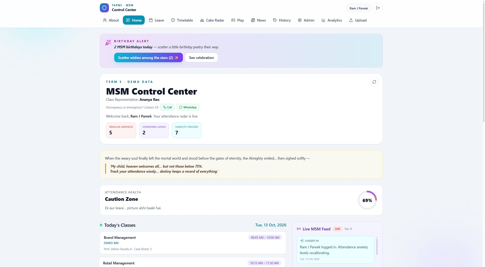
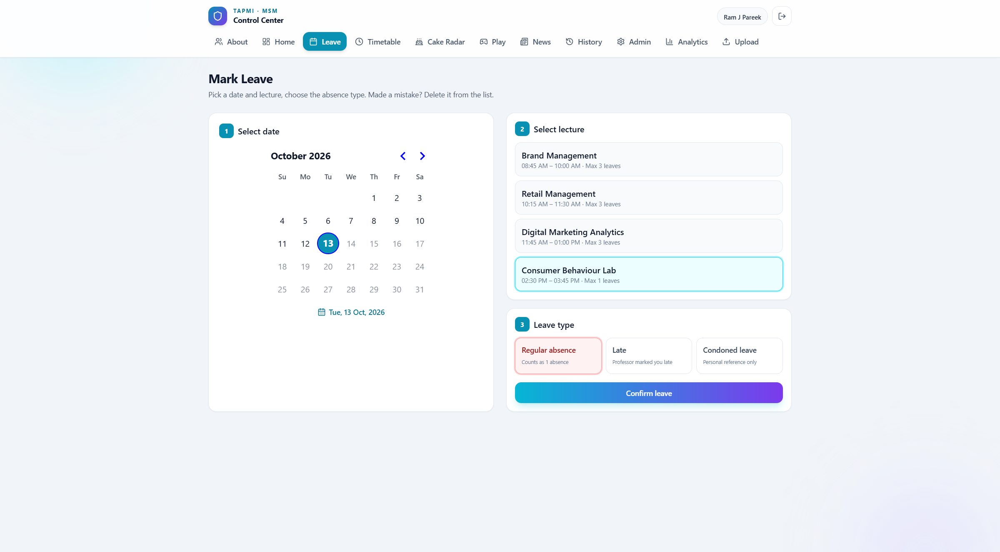
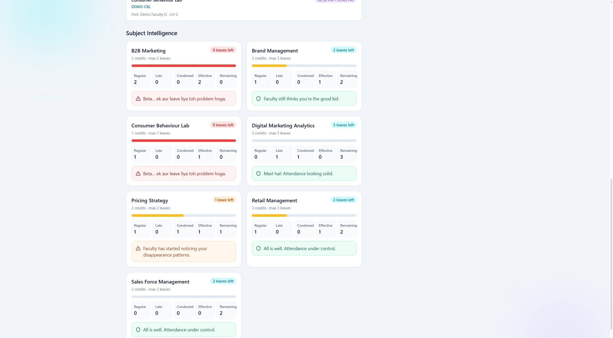
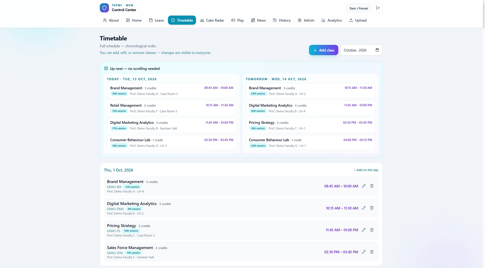
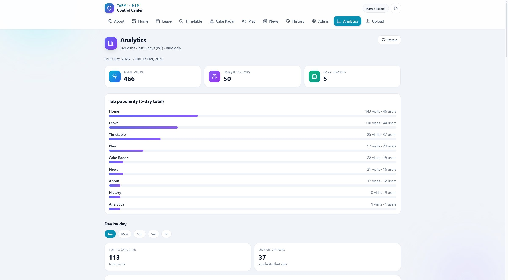
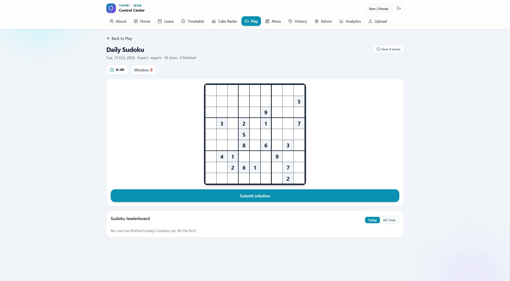
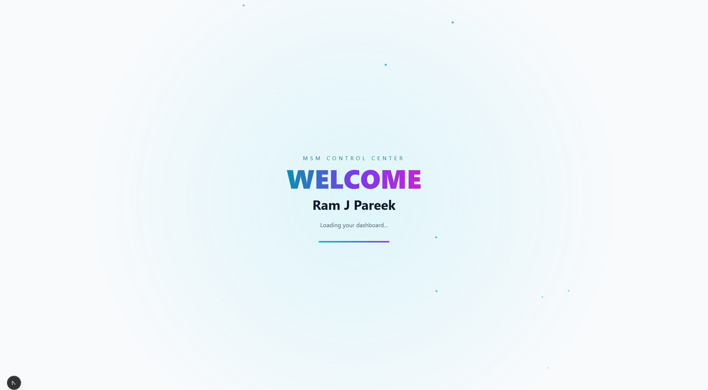
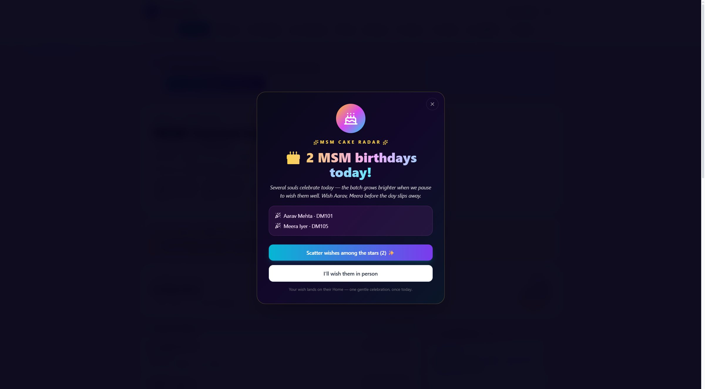
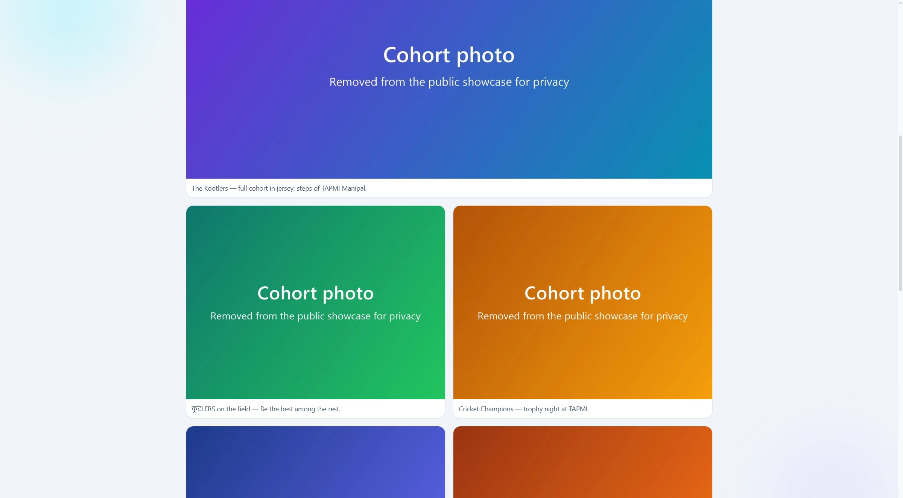

# MSM Control Center (public showcase)

Attendance and cohort companion built for the MSM (Marketing and Sales Management) cohort at TAPMI. Developed by Ram J Pareek.

**Live demo:** https://msm-control-center-showcase.vercel.app
**Demo login:** roll number `DM136` (admin view) or any `DM101` to `DM150`, password `demo1234`
**Portfolio and case study:** https://ram-pareek-portfolio.vercel.app/#msm

| Dashboard | Mark leave | Per-subject risk |
|---|---|---|
|  |  |  |
| **Timetable** | **Admin analytics** | **Daily Sudoku** |
|  |  |  |
| **Welcome animation** | **Birthday celebration** | **About page (photos removed)** |
|  |  |  |

## What this repository is

This is a public copy of the production app's source code with all real cohort data removed. The screens, logic and animations are the production code. Only the data is different:

- Every student, the class representative, faculty names, subjects, leaves, page visits and leaderboard stats are fictional (see `src/lib/students.ts` and `prisma/seed.ts`).
- Cohort photos on the About page are replaced with placeholders.
- The cohort password, phone numbers, roll numbers and email addresses of real people are not included.
- Production-only scripts, deployment notes, Android/Capacitor build files and scheduled jobs (emails, push notifications) are left out.

The hosted demo runs on a bundled SQLite database (`prisma/demo.db`) that is copied to temporary storage when the server starts (`src/instrumentation-node.ts`). Changes you make in the demo are temporary and reset when the server restarts.

## Features you can try

- Welcome animation after sign-in and a dashboard with an attendance-health score
- Mark leave: pick a date and lecture, then choose regular absence, late or condoned leave
- Per-subject risk cards (leave allowance equals subject credits) with warning and critical alerts
- Live cohort feed (logins, leaves, alerts, birthday wishes)
- Timetable with today/tomorrow view and add, edit or remove class
- Cake Radar birthday celebration
- Daily Sudoku and daily quiz with leaderboards
- Admin analytics of tab visits (admin account only)

## Run locally

```bash
npm install
cp .env.example .env   # then set DATABASE_URL="file:./dev.db" and any JWT_SECRET
npm run db:setup:local
npm run dev
```

Open http://localhost:3000 and sign in with `DM136` / `demo1234`.

## Stack

Next.js 15, React 19, TypeScript, Prisma (PostgreSQL in production, SQLite for local and demo), Tailwind CSS, Framer Motion, date-fns, xlsx (timetable upload), nodemailer and web-push (disabled in this showcase).

## Note on AI

The app was built with AI-assisted development tools. The finished app itself has no AI or machine-learning features.
